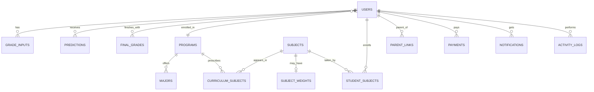

# GradePredict AI: System Overview

Colegio de Santa Rita de San Carlos, Inc.

## What the system does

GradePredict AI estimates the grade a student is heading toward in each subject, using five scores the school records during the term. It flags students who are likely to fall below passing early enough for the teacher, adviser or parent to act. Around that core it handles the records a small college needs: programs and curriculum, sections, enrollment, fees and payments, announcements, and account management.

## Technology

PHP 8 with PDO, MySQL or MariaDB (XAMPP is enough), plain HTML, CSS and JavaScript, Chart.js for charts. No framework. All pages share one stylesheet (assets/css/style.css) and one script (assets/js/app.js).

## Users and what each can do

Student: sees own predictions, subjects, grade history, balance; updates attendance, assignments, quizzes and participation (past grades are locked to teachers and admins); flags a prediction that looks wrong; edits own profile and preferences.

Teacher: sees only the class sections and subjects an admin assigned; edits grades for those students; can add students to the class; can approve student and parent sign-ups.

Parent: read-only view of linked children's predictions and status.

Administrator (also acting as registrar): everything above plus programs and majors (with program length), curriculum, sections, subjects and prediction weights, grading sheets and honors, fees and payments, announcements, users and approval permissions, the account generator, model accuracy, reports (CSV and print), activity logs, backup and restore.

## How a prediction is computed

Predicted grade = past grades x 0.40 + attendance x 0.25 + assignments x 0.15 + quizzes x 0.10 + participation x 0.10, each score on a 0 to 100 scale, result limited to 0 to 100. The weights are the defaults; an admin can give a subject its own weights (they must total 100%).

Status bands: Excellent 90 and above, Very Good 80 to 89, Good 70 to 79, Fair 60 to 69, Poor below 60. Risk: High below 60, Medium 60 to 69, Low 70 and above. A PH-style GPA (1.00 to 5.00) is shown beside the percentage.

Two extra signals are shown but never change the number: a trend (Improving, Stable, Declining, from the last few predictions) and a confidence level (Low, Medium, High, from how many times data was recorded).

This is a transparent weighted model, not a trained machine-learning model. That is deliberate: every number can be traced to its inputs and explained to a student or parent. The Model Accuracy page measures how close predictions were to final grades, so the weights can be tuned with evidence.

## Main modules

Account access: registration with admin or teacher approval, login throttling, remember-me, forced password change for generated accounts, token-based password reset.

Account generator: paste a list of names, get school email addresses and random temporary passwords, with a preview first and a CSV/print sheet afterwards.

Registrar: programs (6 months to 4 years long), majors, curriculum by program, major, year and semester, sections, subjects.

Grading sheets and honors: for any school year the registrar can filter by program, year level, semester and subject and get (1) a grading sheet per subject with the five components, predicted grade, final grade, grade equivalent and remarks, (2) a consolidated sheet with every subject and each student's GWA, and (3) the honors outlook. Everything downloads as one Excel workbook (consolidated sheet, honors sheet and one sheet per subject), as CSV, or prints with signature lines.

GWA is the sum of grade equivalent times units divided by total units, using the scale already in the system (97 and above = 1.00 down to 75 = 3.00, below 75 = 5.00, so lower is better). A recorded final grade is used when there is one, otherwise the latest prediction, and the sheet says which (Final, Predicted or Mixed).

Honor designation: Summa Cum Laude up to 1.20, Magna Cum Laude up to 1.45, Cum Laude up to 1.75, with no failing grade, no grade worse than 2.50, and a grade or prediction for every enrolled subject. These limits are defaults and the registrar edits them on the Honors outlook tab to match the student handbook. A student is marked Qualified or Not qualified and every reason is listed. Students also see their projected GWA and honors outlook on their Profile and Settings screen.

Cashier: fee structures, payments, running balance, enrollment hold when a balance is unpaid.

Academics: data inputs, predictions, grade history with a full audit trail, grade flags, model accuracy.

Communication: announcements to everyone, a program or a section; in-app notifications.

## Data model (main tables)

users (role, program, major, year level, approval status, preferences), programs (with duration in months), majors, subjects, subject_weights, sections, curriculum_subjects, student_sections, student_subjects, teacher_subjects, parent_links, grade_inputs, grade_input_history, predictions, final_grades, grade_flags, fee_structures, payments, advising_notes, announcements, notifications, activity_logs, remember_tokens, password_resets, settings.

## Security measures

CSRF token on every form, parameterized SQL everywhere, output escaping, bcrypt password hashing, session ID regenerated on login, HttpOnly cookies, 30 minute idle timeout, lockout after 5 failed logins for 10 minutes, content security policy and other security headers, upload checks by real file type and size, CSV export protected against spreadsheet formula injection, idempotency tokens so a double click cannot create duplicate accounts, account approval before first access, and role checks on every page and again inside sensitive actions.

## Known limitations (say these before the panel asks)

The predictor is a weighted formula, not machine learning. No email is sent: password reset links and generated passwords are shown on screen or handed over by the admin. Language is English only. The email notification and study reminder switches save the preference, but nothing sends mail yet. No class scheduling, LMS, admissions or document generation. Accuracy figures depend on final grades being recorded; until then the Model Accuracy page is empty. The honors outlook is a projection from predicted grades until final grades are recorded, and the honor limits are common defaults that must be confirmed against the school's handbook.
